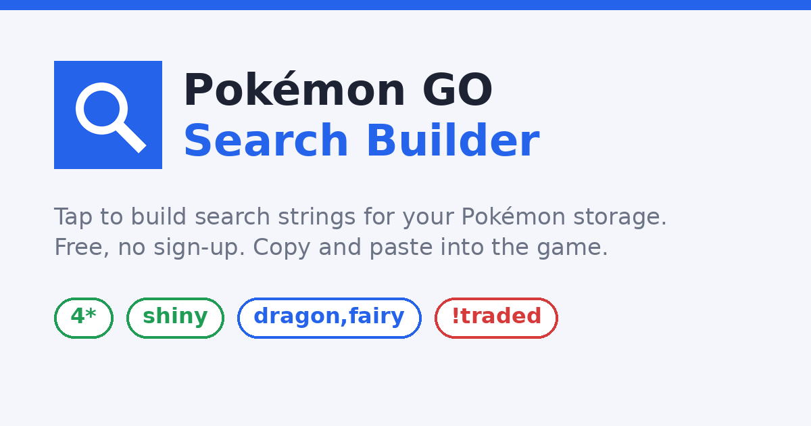

# Pokémon GO Search Builder

**▶ Use it here: https://hurstmatthewm-png.github.io/pokemon-go-search/**

Build Pokémon GO search strings by tapping instead of typing. Pick what you want to include, allow or exclude (IVs, types, shiny, legendary, CP and HP ranges, tags, moves and more), then copy the result and paste it into the search bar in the game.

## Features

- Tap-to-build: green = must have, blue = any of, red = exclude
- Number ranges for CP, HP, distance, age and Pokédex number
- Custom tags and move names
- One-tap copy
- Ready-made searches: transfer junk, hundos, nundos, Great/Ultra League candidates, lucky trade fodder and more
- Save your own searches with a name (stored on your device, no account)
- Picks up where you left off
- Share a search as a link
- Paste in any search string to edit it
- Trade list builder: pick regional forms (e.g. Hisuian Voltorb but not Kanto Voltorb), with name suggestions, spell-checking and shareable lists
- Battle League: what's on now: a ready-made search for each GO Battle League league and cup that's currently live, using PvPoke's rankings. Type any rank range for each one (e.g. 1 to 100), or leave it blank for every ranked Pokémon; each box shows how far that cup's rankings go. Updates itself every few hours
- Works offline once you've opened it
- Works on any phone; add it to your home screen to use it like an app
- Free, no sign-up, no cookies

## How search strings work

In Pokémon GO, `&` means AND, `,` means OR and `!` means NOT. Commas group before ampersands, so `a&b,c&!d` reads as "a AND (b OR c) AND NOT d".

## Support

If it saves you time, you can [buy me a coffee](https://buymeacoffee.com/muttchew) ☕

Pokémon names and regional form data from [PokéAPI](https://github.com/PokeAPI/pokeapi) (BSD-3-Clause).

Battle League schedule from [LeekDuck](https://leekduck.com/events/) via [ScrapedDuck](https://github.com/bigfoott/ScrapedDuck). PvP rankings from [PvPoke](https://github.com/pvpoke/pvpoke) (MIT licence).

## How the Battle League section stays up to date

A GitHub Actions workflow (`.github/workflows/pvp-data.yml`) runs every 6 hours. It runs `scripts/update-pvp-data.mjs`, which reads the league calendar and PvPoke's rankings and saves them to `data/pvp.json`, then publishes the site. If a source is down or sends something odd, the last good data is kept, the site still publishes, and the run is marked as failed so GitHub sends an email. The site warns visitors if the data is more than 2 days old.

---

Fan-made tool. Not affiliated with or endorsed by Niantic, Nintendo or The Pokémon Company.
